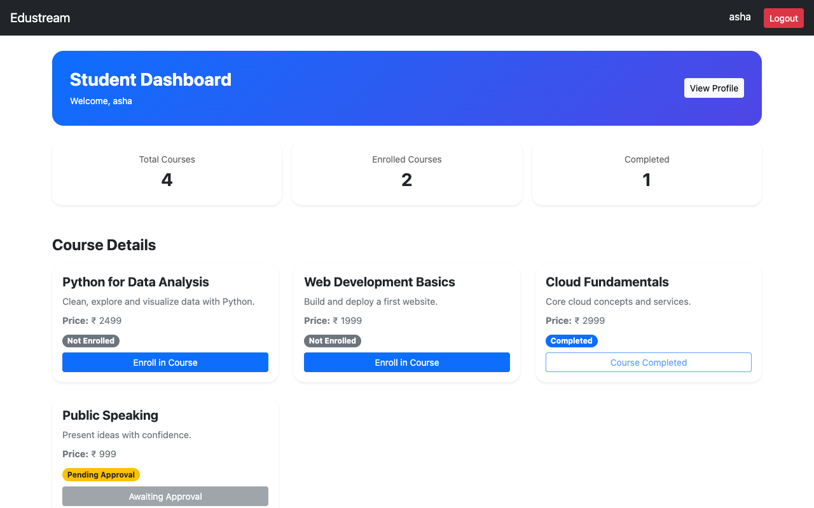
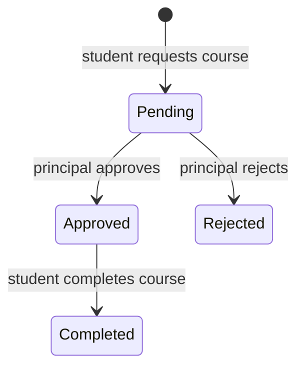
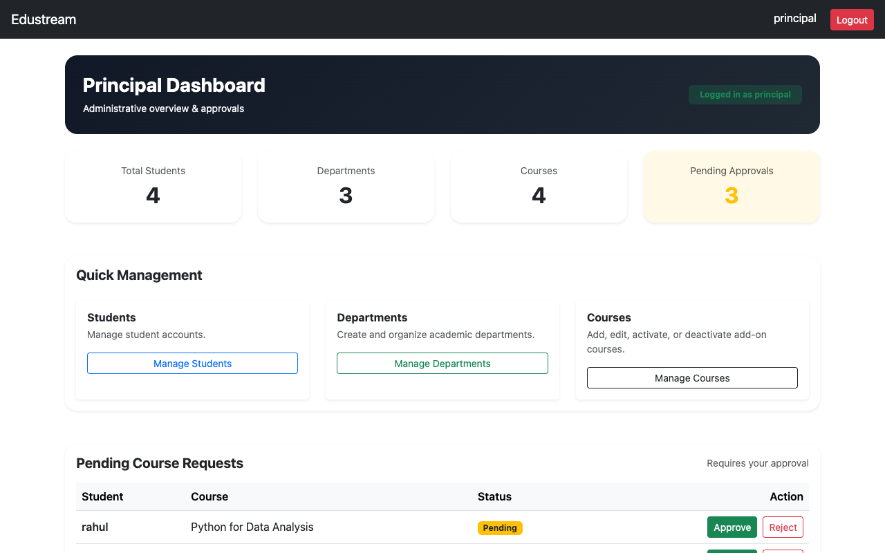
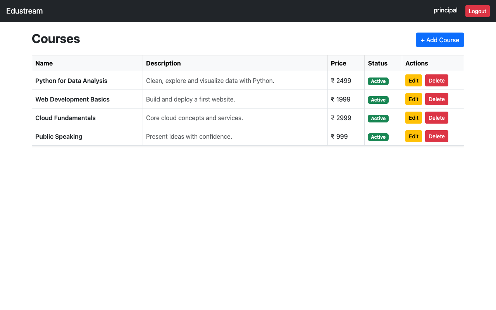

# Edustream

A role-based learning management system built with Django and PostgreSQL. Students browse add-on courses and request enrollment, and the principal reviews each request from an admin dashboard.



## Features

**Students**
- Register with a department and profile details, and receive a welcome email
- Browse active add-on courses and request enrollment
- Track each course as pending, approved, rejected or completed
- View and edit their profile, including a photo
- Reset a forgotten password by email

**Principal**
- See totals and pending requests on a dashboard
- Approve or reject course requests
- Manage students, departments and courses

## How enrollment works



A database constraint allows one request per student and course, so duplicates can't be created.

## Access control

- A custom `Student` model extends Django's `AbstractUser`.
- `PublicAccessMiddleware` redirects logged-out visitors from every page except the public ones.
- Admin views require a logged-in staff user, and login redirects each user by role.
- Actions that change data accept POST only and are protected by Django's CSRF checks.

## Tech stack

| Layer | Technology |
|-------|-----------|
| Backend | Python, Django 6.0 |
| Database | PostgreSQL |
| Frontend | Django templates, Bootstrap 5 |
| Email | Django SMTP backend |

## Project structure

```
edustream/    Project settings and URLs
student/      Student model, auth, enrollment, profile, access middleware
principal/    Admin dashboard, department and course models, approvals
templates/    Shared base and landing templates
```

## Screenshots

| Principal dashboard | Course management |
|---|---|
|  |  |

## Running locally

**Prerequisites:** Python 3.12 and PostgreSQL.

```bash
git clone https://github.com/muhammedsiinanmp/Edustream.git
cd Edustream

python3 -m venv venv && source venv/bin/activate
pip install -r requirements.txt

cp .env.example .env    # set SECRET_KEY and your database credentials
createdb edustream

python manage.py migrate
python manage.py createsuperuser    # creates the principal account
python manage.py runserver
```

Open http://localhost:8000. Log in with the superuser account to reach the principal dashboard.

## Tests

The tests need a running PostgreSQL server and a `.env` file. Settings read the database credentials and `EMAIL_PORT` from it, and startup fails if `EMAIL_PORT` is missing. Django creates a separate test database, so the `DB_USER` role must be allowed to create databases.

```bash
python manage.py test
```

The suite covers the password reset flow, enrollment rules, role checks, CSRF protection, page access for each role and profile photo upload.

CI runs the same tests against PostgreSQL 18 on every pull request and on pushes to `main`, using dummy values set in `.github/workflows/ci.yml`.

## License

[MIT](LICENSE)
