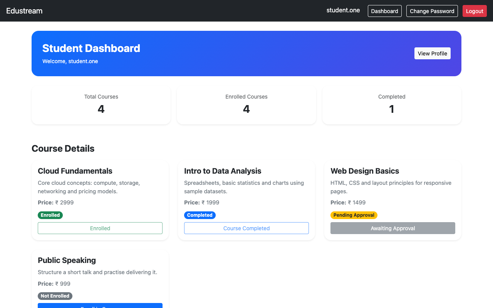
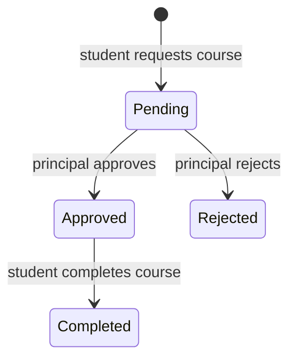
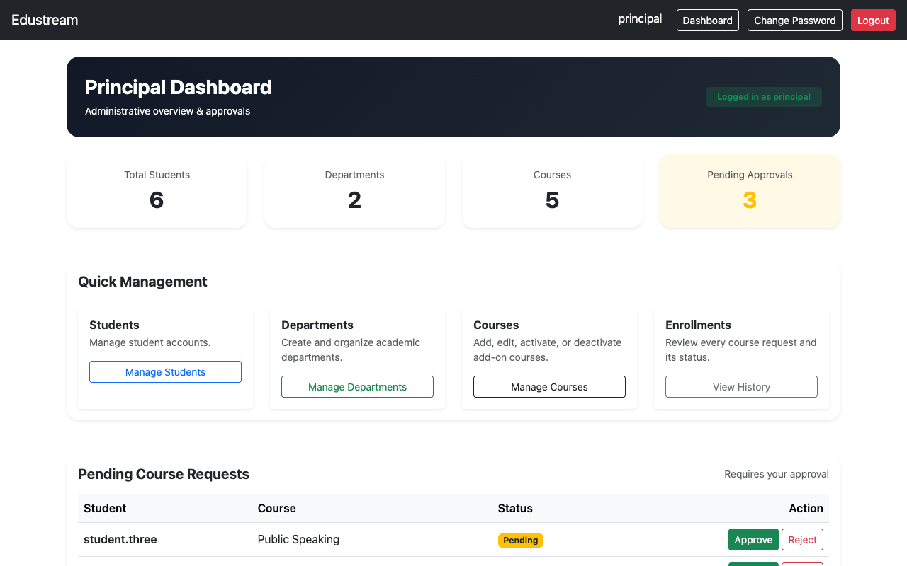
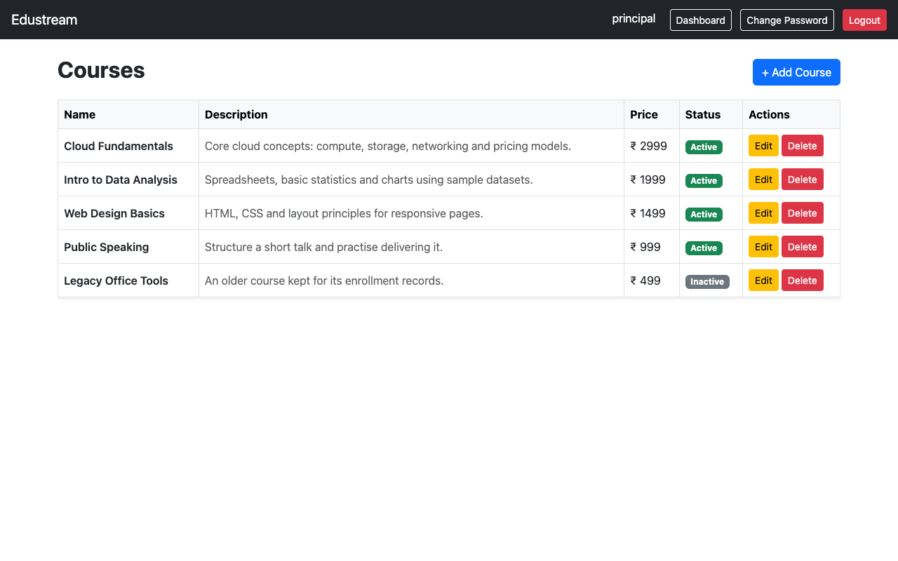

# Edustream

A role-based learning management system built with Django and PostgreSQL. Students browse add-on courses and request enrollment, and the principal reviews each request from an admin dashboard.



## Features

**Students**
- Register with a department and profile details, and receive a welcome email
- Browse active add-on courses and request enrollment
- Track each course as pending, approved, rejected or completed, and get an email when a request is approved or rejected
- Mark approved courses as completed from the enrolled courses table, even if the course was deactivated later
- View and edit their profile, including a JPEG, PNG or WebP photo up to 2 MB
- Change their password, or reset a forgotten one by email

**Principal**
- See totals and pending requests on a dashboard
- Approve or reject course requests
- Review the enrollment history across all statuses
- Manage students, departments and courses
- Deactivate a student so they can no longer log in, and reactivate them later

On narrow screens the tables hide secondary columns, such as roll number, department, description and price, and stack their buttons. At 375px wide, a common phone width, every action button is visible without scrolling sideways.

## How enrollment works



A database constraint allows one request per student and course, so duplicates can't be created. Only active courses can be requested, and staff accounts can't request courses.

A course that has enrollment records can't be deleted. Set its status to Inactive instead.

A student who has enrollment records can't be deleted either, from the principal's student list or from Django admin, which shows its own page listing the protected records. Use Deactivate instead. A deactivated student can't log in, an open session ends at their next request, their records stay in the enrollment history, and the student list marks them Inactive. Reactivate lets them log in again. Students without enrollment records can still be deleted, and staff accounts can't be deleted, deactivated or edited from the student list.

## Access control

- A custom `Student` model extends Django's `AbstractUser`.
- `PublicAccessMiddleware` redirects logged-out visitors to the landing page. It exempts the landing, login and register pages, and everything under `/static/`, `/media/`, `/admin/`, `/student/password-reset/` and `/student/reset/`.
- Because `/media/` is exempt, anyone who has a profile photo's URL can open it without logging in. New uploads get random UUID filenames, so their URLs can't be guessed.
- Principal views require a logged-in staff user. Logged-in students get a 403 page, `templates/403.html`, that links back to their dashboard. Login redirects each user by role.
- Enrolling, completing a course, logging out, approving, rejecting, deactivating, reactivating and every delete action accept POST only. These and all other forms are protected by Django's CSRF checks.
- Registration, the principal's Add Student form, password change and password reset apply `AUTH_PASSWORD_VALIDATORS`.
- Emails are stored in lowercase, and a database constraint keeps them unique regardless of letter case.
- `Student.save()` checks a new photo against the same rules as the forms, so code that saves a student without a form gets a `ValidationError` instead of storing a photo that breaks them.

## Tech stack

| Layer | Technology |
|-------|-----------|
| Backend | Python, Django 6.0 |
| Database | PostgreSQL |
| Frontend | Django templates, Bootstrap 5 |
| Email | Django SMTP backend |
| Production serving | Gunicorn, WhiteNoise for static files |

## Project structure

```
edustream/    Project settings and URLs
student/      Student model, auth, enrollment, profile, access middleware
principal/    Admin dashboard, department and course models, approvals
templates/    Shared base, landing, 403 and password templates
```

## Screenshots

| Principal dashboard | Course management |
|---|---|
|  |  |

## Running locally

**Prerequisites:** Python 3.12 and PostgreSQL.

```bash
git clone https://github.com/muhammedsiinanmp/Edustream.git
cd Edustream

python3 -m venv venv && source venv/bin/activate
pip install -r requirements.txt

cp .env.example .env    # set SECRET_KEY, your database credentials and SMTP credentials
createdb edustream

python manage.py migrate
python manage.py createsuperuser    # creates the principal account
python manage.py runserver
```

Open http://localhost:8000. Log in with the superuser account to reach the principal dashboard.

Email needs `EMAIL_HOST`, `EMAIL_HOST_USER`, `EMAIL_HOST_PASSWORD` and `DEFAULT_FROM_EMAIL` in `.env`. Without a working mail server, registration, approvals and password reset requests still complete, the failure is written to the log, and no email arrives.

## Tests

The tests need a running PostgreSQL server and `SECRET_KEY` plus the `DB_*` values, set in `.env` or the environment. Most tests error with `ImproperlyConfigured` if `SECRET_KEY` is missing. Django creates a separate test database, so the `DB_USER` role must be allowed to create databases.

```bash
python manage.py test
```

The suite covers registration, login and logout, password reset and change, enrollment rules, role checks, CSRF protection, page access for each role, principal CRUD, student deactivation and protected deletion, the 403 page, profile editing, photo upload rules, email failures, query counts, the email migration and the production settings.

CI runs the same tests against PostgreSQL 18 on every pull request and on pushes to `main`, using dummy values set in `.github/workflows/ci.yml`.

## Deployment

Any `DEBUG` value other than `True` runs in production mode, which is the behaviour described here. Set these on the host, using `.env.example` as the list:

| Variable | Purpose |
|----------|---------|
| `SECRET_KEY` | Required. Use a long random value. |
| `DEBUG` | Leave unset or `False`. |
| `DB_NAME`, `DB_USER`, `DB_PASSWORD`, `DB_HOST`, `DB_PORT` | PostgreSQL connection. |
| `ALLOWED_HOSTS` | Comma-separated hostnames. Required when `DEBUG` is off. |
| `CSRF_TRUSTED_ORIGINS` | Comma-separated origins including the scheme, such as `https://example.com`. Needed when a proxy changes the host or scheme Django sees. |
| `EMAIL_HOST`, `EMAIL_HOST_USER`, `EMAIL_HOST_PASSWORD`, `DEFAULT_FROM_EMAIL` | SMTP account. |
| `EMAIL_PORT`, `EMAIL_USE_TLS` | Default to `587` and off. |
| `EMAIL_TIMEOUT` | Seconds before an SMTP attempt gives up. Defaults to `10`. |
| `STATIC_ROOT`, `MEDIA_ROOT` | Default to `staticfiles/` and `media/` in the project. |
| `LOG_LEVEL` | Defaults to `INFO`. Logs go to the console. |
| `SESSION_COOKIE_SECURE`, `CSRF_COOKIE_SECURE`, `SECURE_SSL_REDIRECT` | Default to on when `DEBUG` is off. |
| `SECURE_HSTS_SECONDS` | Defaults to `31536000` when `DEBUG` is off and `0` when it is on. |
| `SECURE_HSTS_INCLUDE_SUBDOMAINS`, `SECURE_HSTS_PRELOAD` | Default to off because they also affect other sites on the domain. `manage.py check --deploy` warns until both are on. |
| `TRUST_X_FORWARDED_PROTO` | Defaults to off. When on, Django treats a request as HTTPS if `X-Forwarded-Proto` is `https`, whichever address it came from. Gunicorn can also do this on its own; see [Behind a proxy](#behind-a-proxy). |

Then run:

```bash
python manage.py migrate
python manage.py collectstatic --noinput
gunicorn edustream.wsgi
```

WhiteNoise serves the collected static files, so `collectstatic` must run before the app starts.

If two existing accounts have emails that differ only by letter case, `migrate` stops before changing any data and lists the student ids. Give each account its own address, then run `migrate` again.

### Behind a proxy

Gunicorn 26.2.0, the pinned version, reads `X-Forwarded-Proto`, `X-Forwarded-Ssl` and `X-Forwarded-Protocol` itself when a request comes from an address in its `forwarded_allow_ips` setting. That setting defaults to `127.0.0.1,::1`, or to the `FORWARDED_ALLOW_IPS` environment variable if it is set, and connections over a UNIX socket are always trusted. When one of those headers says HTTPS, Gunicorn marks the request as HTTPS and Django believes it, even with `TRUST_X_FORWARDED_PROTO` off.

So a proxy on the same machine is trusted by default. Whichever way the header is trusted, the proxy in front of the app must:

1. Overwrite `X-Forwarded-Proto` on every request with the scheme the client actually used, never passing on a value the client sent.
2. Remove any `X-Forwarded-Ssl` and `X-Forwarded-Protocol` headers sent by the client.
3. Be the only route to Gunicorn, so clients can't connect to it directly from a trusted address.

To choose which proxy addresses Gunicorn trusts, pass them with `--forwarded-allow-ips`. Replace `10.0.0.5` with your proxy's address; several can be given, separated by commas, and CIDR ranges are accepted:

```bash
gunicorn edustream.wsgi --forwarded-allow-ips="10.0.0.5"
```

To make Gunicorn trust no address and leave the decision to Django, pass an empty value and turn on `TRUST_X_FORWARDED_PROTO`:

```bash
gunicorn edustream.wsgi --forwarded-allow-ips=""
```

If neither Gunicorn nor Django trusts the proxy, every request looks like plain HTTP and the HTTPS redirect loops.

### Profile photos in production

Photos are saved to `MEDIA_ROOT` on the local disk, and Django serves `/media/` only when `DEBUG` is on. WhiteNoise serves static files only. The host must do both of these, or photos will show as broken images or disappear:

1. Keep `MEDIA_ROOT` on storage that survives restarts and redeploys.
2. Serve `/media/` from that directory using the web server or proxy in front of the app.

## License

[MIT](LICENSE)
